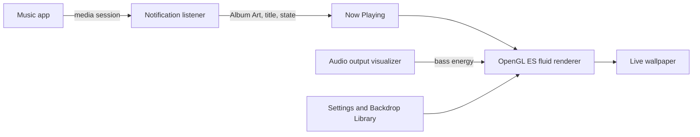

<div align="center">

<br />


# Sonora

**Your music, painted on your wallpaper.**

Sonora is an Android live wallpaper that turns the album art of whatever you are listening to into a soft, slowly flowing fluid. It changes with every song, works with any music app, and can pulse with the beat.

<br />

<a href="LICENSE"></a>


<a href="https://github.com/leo-snczki/sonora/releases/latest"></a>
<a href="https://github.com/leo-snczki/sonora/stargazers"></a>
<a href="https://github.com/leo-snczki/sonora/forks"></a>

<br />
<br />

<a href="#features">Features</a> ·
<a href="#how-it-works">How it works</a> ·
<a href="#requirements">Requirements</a> ·
<a href="#install">Install</a> ·
<a href="#how-to-build">How to build</a> ·
<a href="#faq">FAQ</a> ·
<a href="#support">Support</a> ·
<a href="#star-history">Star history</a> ·
<a href="#license">License</a>

</div>

<br />

## Features

- **Follows any music app.** Sonora reads Now Playing from the system's media sessions, so it works with any player that shows media controls, including modded ones like YT Music ReVanced.
- **Two fluid styles.** *Flow* melts the album art into drifting colour that walks smoothly to each new song. *Cover* keeps the artwork recognisable while it ripples.
- **Beat Pulse.** The fluid swells with the bass. It listens to what your device plays, never the microphone, and you choose the strength.
- **Motion you control.** Fluid scale from *Calm* to *Turbulent*, plus separate speeds for paused and playing.
- **Graphics.** Soft blur or *Fluted glass*, with brightness, vertical flip and horizontal mirror.
- **Backdrop Library.** Eight built-in Backdrops (Dusk, Lagoon, Ember, Moss, Orchid, Glacier, Citrus, Graphite) for when nothing is playing. You can also save the current Album Art or upload your own image, with a square crop, rotation and zoom.
- **Keeps the mood.** Optionally keep the last Album Art after pausing, or even after rebooting.
- **Guided setup.** A setup card walks you through the wallpaper, notification access and audio access, and warns you about phone makers that kill background apps.
- **Private by design.** No account, no internet permission, no analytics. Nothing leaves your device.
- **English and Portuguese (Brazil).**

## How it works



1. **Now Playing.** Music apps publish what they play through an Android *media session*. With notification access, Sonora's listener reads the active session: the Album Art, the title, the artist and whether it is playing. It never parses notification contents.
2. **Fluid rendering.** The live wallpaper runs a fluid simulation in plain OpenGL ES 3.0. The Album Art seeds the colours, and a crossfade carries the fluid from one song to the next. When nothing is playing, the selected Backdrop takes its place.
3. **Beat Pulse.** If you allow it, the Android visualizer reads the device's audio output, and the bass energy pushes the fluid outward. Audio is analysed in memory only. It is never recorded or stored.
4. **Settings.** Every choice is saved on the device with Jetpack DataStore and applied to the wallpaper live.

The code is split into Gradle modules:

| Module | Role |
|---|---|
| `:app` | Entry point, dependency injection (Hilt) |
| `:wallpaper` | The live wallpaper service |
| `:core:render` | OpenGL ES fluid renderer and shaders |
| `:core:media` | Notification listener and Now Playing |
| `:core:domain` | Pure Kotlin rules (scene, timing, settings) |
| `:core:data` | Settings and Backdrop storage |
| `:core:designsystem` | Compose components, fonts and icons |
| `:feature:home` | Settings screen |
| `:feature:backdrops` | Backdrop Library and cropper |

## Requirements

**To use Sonora**

- Android 8.0 (API 26) or newer
- A device with OpenGL ES 3.0 and live wallpaper support
- Notification access, to see what is playing
- *Optional:* audio access, for Beat Pulse only

**To build Sonora**

- JDK 21
- Android SDK with platform 35 (Android 15) and build tools
- Git

## Install

Download the latest `sonora-vX.Y.Z.apk` from [Releases](https://github.com/leo-snczki/sonora/releases/latest), open it on your device and allow installing from that source. Then open Sonora and follow the setup card.

## How to build

```bash
git clone https://github.com/leo-snczki/sonora.git
cd sonora

# Tell Gradle where the Android SDK is (or set ANDROID_HOME)
echo "sdk.dir=$HOME/Android/Sdk" > local.properties

# Debug APK: app/build/outputs/apk/debug/app-debug.apk
./gradlew :app:assembleDebug

# Install it on a connected device
adb install -r app/build/outputs/apk/debug/app-debug.apk

# Unit tests, Robolectric UI tests and lint
./gradlew check
```

**Signed release build.** Without signing variables, the release APK is unsigned. To sign it, point Gradle to your keystore:

```bash
export SONORA_KEYSTORE=/path/to/sonora.jks
export SONORA_KEYSTORE_PASSWORD=...
export SONORA_KEY_ALIAS=...
export SONORA_KEY_PASSWORD=...
./gradlew :app:assembleRelease
```

Pushing a `v*` tag runs the [Release workflow](.github/workflows/release.yml), which builds the signed APK and publishes it to GitHub Releases.

## FAQ

<details>
<summary><b>Why does Sonora need notification access?</b></summary>
<br />
On Android, notification access is the only way for an app to read other apps' media sessions. Sonora uses it only to learn what is playing (Album Art, title, artist and play state). It doesn't read, store or send your notifications.
</details>

<details>
<summary><b>Does Beat Pulse use my microphone?</b></summary>
<br />
No. Beat Pulse reads the audio your device is already playing through the Android visualizer. Android groups that under the "record audio" permission, but Sonora never opens the microphone, and it never records or stores sound. Beat Pulse is optional, and the rest of Sonora works without audio access.
</details>

<details>
<summary><b>Beat Pulse isn't reacting. Why?</b></summary>
<br />
Some players keep their audio away from the visualizer. When that happens, Sonora tells you that it can't hear this Player, and it never falls back to the microphone. The fluid still follows the Album Art.
</details>

<details>
<summary><b>Which music apps work?</b></summary>
<br />
Any app that shows media controls in the notification shade or on the lock screen should work, since they all publish a media session. YT Music ReVanced has been tested on a real device. If your player doesn't work, please <a href="https://github.com/leo-snczki/sonora/issues">open an issue</a>.
</details>

<details>
<summary><b>Does it drain the battery?</b></summary>
<br />
The fluid runs on the GPU only while the wallpaper is visible, and it slows down when the music is paused. You can lower the speed in <i>Motion</i> to save more.
</details>

<details>
<summary><b>Does Sonora collect any data?</b></summary>
<br />
No. Sonora has no internet permission, no account and no analytics. Settings, saved Backdrops and the last Album Art stay on your device.
</details>

<details>
<summary><b>Is it on the Play Store?</b></summary>
<br />
Not yet. Get the APK from <a href="https://github.com/leo-snczki/sonora/releases/latest">Releases</a>.
</details>

## Support

If Sonora brightens your home screen, you can buy me a coffee. It helps keep the project going.

<a href="https://buymeacoffee.com/leosnczki"></a>

Found a bug or have an idea? [Open an issue](https://github.com/leo-snczki/sonora/issues). Please read the [Code of Conduct](CODE_OF_CONDUCT.md) first, and report security issues as described in [SECURITY.md](SECURITY.md).

## Star history

<a href="https://www.star-history.com/#leo-snczki/sonora&Date">
  <picture>
    <source media="(prefers-color-scheme: dark)" srcset="https://api.star-history.com/svg?repos=leo-snczki/sonora&type=Date&theme=dark" />
    <source media="(prefers-color-scheme: light)" srcset="https://api.star-history.com/svg?repos=leo-snczki/sonora&type=Date" />
    
  </picture>
</a>

### Stargazers around the world

<a href="https://starmapper.bruniaux.com/leo-snczki/sonora">
  <picture>
    <source media="(prefers-color-scheme: dark)" srcset="https://starmapper.bruniaux.com/api/map-image/leo-snczki/sonora?theme=dark" />
    <source media="(prefers-color-scheme: light)" srcset="https://starmapper.bruniaux.com/api/map-image/leo-snczki/sonora?theme=light" />
    
  </picture>
</a>

## Built with the help of

<a href="https://github.com/leo-snczki/sonora/graphs/contributors">
  
</a>

## License

Sonora is free software, released under the [GNU General Public License v3.0](LICENSE). You can use, study, share and change it, as long as derived works stay under the same license.

The bundled Manrope and JetBrains Mono fonts are under the SIL Open Font License 1.1, and the Lucide icons are under the ISC License.
